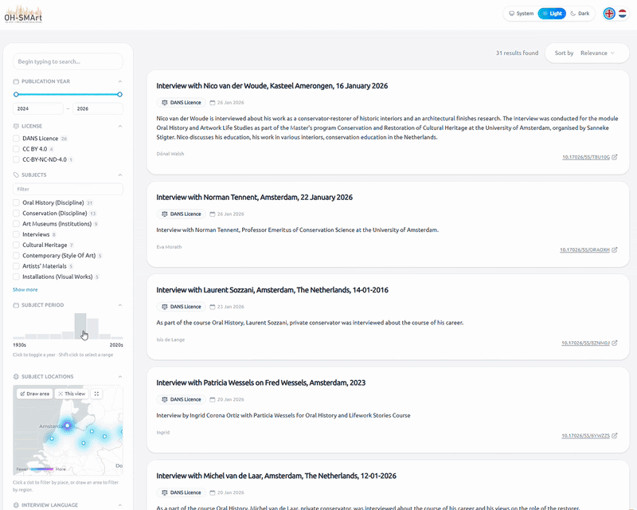

# OH-SMArt data explorer

An interface for explorting oral history specific (OHS) data, as deposited via the OH-SMArt deposit app. Fetches all OH-SMArt datasets from dataverse, reads their files and flattens harvested data into a shape suitable for indexing. Uses Typesense for search, a TanStack Start + React frontend.



## Why and how
Current OHS data is not indexed in Dataverse, as it's not stored in the actual metadata blocks, but in separate json files. This data is therefore not very visible, and not very usable. This project aims to change that, by making the OHS data searchable. Typesense was chosen because it's open source, easy to work with, and lightning fast. Tanstack Start + React was choosen because it's a cutting edge SSR framework.

The OHS data is read by the harvesting script, by searching for datasets containing the file `__generated__form-metadata-public.json` inside the ssh.datastations.nl Dataverse instance. This is a file generated by the ACP and the OH-SMArt data deposit form. These files are then read, processed and inserted into a Typesense index to enable faceted search. The UI takes presents several OHS facets to the user for filtering. Facet types supported are:
-  Checkboxes (single or lists)
-  Ranges, for e.g. dates
-  Year filter with chart visualisation
-  Geospatial data on an interactive map
-  Free text search with configurable search fields and weights
  
The detail page of a dataset provides a link to the dataset on Dataverse. The application is multi-lingual, English and Dutch are provided. Both dark and light themes are catered for, as well as a mobile interface.

## Extendability
This project's UI is easily adapted to different Typesense indexes. For another example, see the [Odissei Portal experiment](https://github.com/Dans-labs/odissei-portal-exp). Another use case could be a supercatalog that indexes several different Dataverses.

For keeping the Typesense index up-to-date, an index update could be triggered by using [Dataverse workflows](https://guides.dataverse.org/en/6.12.1/developers/workflows.html). On publishing a new dataset, the update script should be called. The update/harvest script could, for these purposes, be enhanced by a REST API endpoint.

## Setup for local development

### Typesense
Typesense runs in Docker.

1. **Start Typesense**

```bash
   cp .env.example .env   # set TYPESENSE_API_KEY
   docker compose --env-file .env up -d
```

2. **Create and fill the collection**

```bash
   pip install -r requirements.txt
   set -a; source .env; set +a
   python harvest.py --dry-run     # preview
   python harvest.py               # sync (or incremental sync when already created)
```

When you need to modify the collection schema, you can run:
```bash
   python harvest.py --full        # ignore checksums, re-fetch everything
   python harvest.py --recreate    # drop + recreate the collection (schema change)
```

### Frontend
Multilingual Tanstack Start + TypeScript frontend, running via Vite+.

#### Configuration

Go to the frontend dir `cd portal`, copy `.env.example` and fill in the values:

| Variable             | Description                             |
| -------------------- | --------------------------------------- |
| `TYPESENSE_HOST`     | Typesense server location               |
| `TYPESENSE_PORT`     | Typesense server port                   |
| `TYPESENSE_PROTOCOL` | Typesense server protocol (http, https) |
| `TYPESENSE_PATH`     | Optional sub path for Typesense server  |
| `TYPESENSE_API_KEY`  | Your read only API key for Typesense    |

For local development use `.env.development`, for production use `.env.production`.

#### Running locally

Make sure Vite Plus is installed. If not, install:

```bash
curl -fsSL https://vite.plus | bash
```

and open a new terminal tab.

When Vite Plus is installed, run:

```bash
vp i
vp dev
```

#### Cleanup

Use Vite Plus for linting and code formatting.

```bash
vp check
```

#### Building

```bash
vp build
```

#### Docker

Build the image:

```bash
docker build \
  -t portal-ui .
```

Run the container and specify the required runtime variables:

```bash
docker run --env-file .env.production -p 3000:3000 portal-ui
```

The app will be available at http://localhost:3000.
